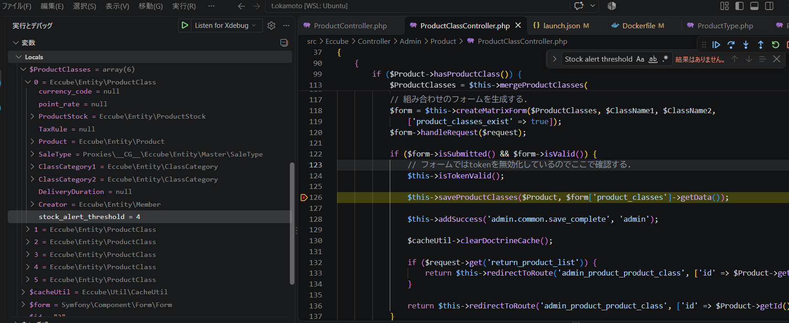

# 課題レポート

## 0. ウォームアップ：EC-CUBE の基本操作

<!-- README.md の「EC-CUBE の基本操作に慣れる（本課題の前に）」を実施して、気づいたことを書いてください -->

### 商品規格・商品登録・フロント表示

<!-- 規格と規格分類、商品と商品規格の関係で分かったこと、フロントでどう表示されたかなど -->
「規格」は項目名、「規格分類」は規格の選択肢　例）規格=素材、規格分類=ポリエステル、綿  
規格が複数の場合、規格1を選択すると規格2が選択可能  
標準での規格追加は2つまで、それ以上はカスタマイズやプラグインが必要  
規格分類のIDは他規格の規格分類からの通し番号→dtb_class_category.class_name_id=dtb_class_name.idで規格と紐づけ  
  
商品(dtb_product)：商品の基本情報を管理する　商品名、説明、画像、商品公開ステータスなど  
商品規格(dtb_product_class)：商品に設定された規格の組み合わせを管理　商品規格ごとに商品コード、価格、在庫数、商品IDと規格分類IDの関連付けなどを設定  
  
商品一覧画面から規格を選択して直接カート投入も可能  
規格未選択の場合はカート追加押下時エラーになる  

### 在庫とフロント表示

<!-- 在庫を0にしたとき、フロントの表示・カートボタンはどう変わったか -->
在庫0の場合、規格分類の選択肢後に「(品切れ中)」が表示される　例）16×16(品切れ中)	  
品切れの項目ではカート追加ボタンは無効になる  

### ページのレイアウト・ブロック

<!-- ブロックとレイアウトの関係で分かったこと -->
ブロックで表示する内容、レイアウトで表示箇所を設定  
ブロック作成していてもレイアウトに設定していないと表示されない  

### 注文の一連の流れ

<!-- フロントでの会員登録・カート・注文、管理画面の受注一覧での確認まで実施して気づいたことを書いてください -->
・フロント  
カートからレジに進む際に会員登録orログインorゲスト購入を選択し、注文手続きを行う  
会員登録では氏名、住所、電話番号、メールアドレス、任意で生年月日や性別、職業を登録 法人の場合は会社名も登録できる  
商品検索・閲覧やカートに入れるまでは未ログインでも動作は同様  
規格や数量を選択してカートに追加する  
カート画面では数量変更は可能だが規格は変更できない  
レジに進むと支払方法やポイント利用を設定できる  
ログインすることでお客様情報やポイントを次注文時に使用できる  
注文確定前に確認画面を挟む  
会員登録し、ログインすることでマイページが利用できる  
注文が完了すると、注文番号が発行され、受注情報として管理される  
注文完了時に、登録したメールアドレス宛ての注文確認メールが送信される  
メールには金額、注文明細、注文者情報、配送情報が記載されている  
MailCatcherを使用することで開発環境でメールの内容を確認できる(実際のメールアドレスに送信せずに確認できる)  
・管理画面  
フロントから注文された内容は受注管理＞受注一覧から確認できる  
受注一覧で受注詳細へのリンク、対応状況などが確認できて、出荷時の対応もできる  
受注一覧の「ID注文者」押下で受注詳細を確認できる  

## 1. GitHub リポジトリ

<!-- 自分のリポジトリの URL を記載してください -->

URL:https://github.com/c-okamoto1231/t.okamoto

## 2. CI 実行結果

GitHub Actions で E2E テストが通ったことがわかる結果を貼り付けてください。
実行ログは一定期間で削除されてしまうため、URL ではなく**結果そのもの**を残します。

次のどちらかで構いません。

- Actions のジョブ画面のスクリーンショット（`docs/` に保存して `` のように貼る）
- テスト結果の出力（`OK (n tests, n assertions)` が見える範囲）をコードブロックで貼る

<!-- ここに貼り付けてください -->
```
okamoto@NPC202207-15:~/projects/t.okamoto$ docker compose exec -e NO_FIXTURES=1 -e APP_ENV=test ec-cube \
  vendor/bin/codecept run acceptance -g stock_alert --env chrome-headless
Xdebug: [Step Debug] Could not connect to debugging client. Tried: host.docker.internal:9003 (through xdebug.client_host/xdebug.client_port).
Codeception PHP Testing Framework v5.1.0 https://stand-with-ukraine.pp.ua
[Groups] stock_alert 

Acceptance Tests (5) -----------------------------------------------------------------------------------------------------------------------------------------------
✔ StockAlertAdminCest: 商品規格編集画面で在庫アラート閾値を入力・保存できる(11.22s)
✔ StockAlertAdminCest: 在庫アラート閾値に負の値を入力すると保存されない(16.06s)
✔ StockAlertAdminCest: 商品一覧画面で「在庫僅少のみ」にチェックすると、閾値以下の在庫を持つ商品だけが表示される(10.16s)
✔ StockAlertFrontCest: 商品詳細画面で在庫が閾値以下の規格を選ぶと「残りわずか」が表示される(12.30s)
✔ StockAlertFrontCest: 規格を切り替えると「残りわずか」の表示/非表示が追従する(10.00s)
--------------------------------------------------------------------------------------------------------------------------------------------------------------------
Time: 01:00.404, Memory: 44.50 MB

OK (5 tests, 51 assertions)
```

## 3. 動作確認の記録

E2E テストが検証しているのは主要な動作だけです。**テストが通っていても、以下のケースは壊れている可能性があります。**

実際に管理画面・フロント画面を操作して、**自分の目で見た結果**を書いてください。
「期待通りに動くはず」ではなく、実際に画面がどうなったかを書くのがポイントです。
想定と違う動きを見つけた場合、それ自体が価値のある記録です。直す前に記録してください。

| #   | 確認するケース               | 操作                                                                                       | 画面はどうなったか（記入） |
| --- | ---------------------------- | ------------------------------------------------------------------------------------------ | -------------------------- |
| 1   | 閾値が未設定（空欄）の規格   | 閾値を空欄のまま保存 → フロント商品詳細でその規格を選ぶ                                    | カート追加可能、残り僅かの表示なし|
| 2   | 同上（管理画面の絞り込み）   | 商品一覧で「在庫僅少のみ」にチェックして検索する                                           | 検索結果に表示されない|
| 3   | 在庫数と閾値が同じ           | 在庫 3・閾値 3 の規格を作り、フロントでその規格を選ぶ                                      | 「残りわずか」が表示される|
| 4   | 在庫数が 0 の規格            | 在庫 0・閾値 3 の規格を作り、フロントで選ぶ。カートボタンと品切れ表示も合わせて見る        | 規格分類サイズが「16×16(品切れ中)」の表示になる、カートボタンは「ただいま品切れ中です」の表示で無効化される|
| 5   | 在庫数無制限の規格           | 「在庫無制限」にチェックし閾値も設定 → フロントで選ぶ／「在庫僅少のみ」で検索する          | フロントで選んだ場合「残りわずか」が表示されない／「在庫僅少のみ」で検索した場合表示されない|
| 6   | 規格を持たない商品           | 規格なしの商品のフロント詳細を開き、**開発者ツールのコンソール**にエラーが出ていないか見る | 在庫アラート機能に起因するJavaScriptエラーなし|
| 7   | 規格が未選択のとき           | フロント商品詳細で、規格の選択を「選択してください」に戻す                                 | 「残りわずか」が表示されていた場合、規格未選択変更時に非表示になる|
| 8   | 閾値以下の規格を複数持つ商品 | 1 つの商品の複数の規格を閾値以下にして「在庫僅少のみ」で検索し、一覧に何件並んだか見る     | 3規格が閾値以下の場合、商品名は1件表示される|
| 9   | 負の値の保存                 | 開発者ツールで閾値入力欄の `min` 属性を削除してから `-1` を保存する                        | 入力欄にmin属性が存在しないが、負の値が入力エラーになることを確認|

### 想定と違った箇所と、その対応
9.負の値の保存  
min属性がないため想定の操作ができていないが、value値変更後保存を行いエラーとなることを確認  
ProductClass.phpに@Assert\PositiveOrZeroを記載しているため動作としては問題ないと判断  

<!-- 上の表で想定と違う動きがあった場合、原因と直した内容を書いてください。何もなければ「なし」と書いてください -->

### ブレークポイントで値の流れを確認する

管理画面で入力した閾値が、実際にどこを通って保存されるのかを Xdebug で確認してください。

1. 商品規格編集画面で「登録」を押したときに通る処理のどこかに、ブレークポイントを置く
2. 閾値を入力して保存し、そこで実行が止まることを確認する
3. 変数の中身を見て、入力した値が入っていることを確認する
4. **停止した状態の VS Code の画面をスクリーンショットで撮り、リポジトリに保存して以下に貼る**
   （例：`docs/breakpoint.png` に置いて `` と書く）

<!-- ここにスクリーンショットを貼ってください -->

**どのファイルの何行目にブレークポイントを置きましたか。なぜそこを選びましたか。**

<!-- ここに記入 -->
- ProductClassController.php の126行目
- `handleRequest()` で入力値がProductClassに入り `isValid()` で検証を通った直後で、DB に保存する直前の地点のため
**そこで見た変数には、どんな値が入っていましたか。**

<!-- ここに記入 -->
- 該当の箇所に入力した閾値「4」が入っていた
## 4. 設計判断の根拠

自分が書いたコードについて、以下の問いに答えてください。
AI に聞いて確認しても構いませんが、**返ってきた答えをそのまま貼るのではなく、自分のコードを実際に開いて確かめてから**書いてください。

### 4-1. 値が保存されるまでの経路

管理画面の入力欄に入れた数値が `dtb_product_class` テーブルに保存されるまで、どのクラス・メソッドを順に通りますか。ファイル名とメソッド名を挙げてください。

<!-- ここに記入 -->
1.src/Eccube/Controller/Admin/Product/ProductController.php → edit()  
新規→new ProductClass() を作って Product::addProductClass() で紐づけ  
編集→既存の ProductClass を取り出し、$form['class']->setData($ProductClass) でフォームに渡す  
2.src/Eccube/Form/Type/Admin/ProductType.php → buildForm()  
'class' という子フォームとして ProductClassType を組み込む  
商品規格情報、基本情報、詳細な説明、サブ情報、右ブロック、タグ、画像  
3.src/Eccube/Form/Type/Admin/ProductClassType.php → buildForm()  
商品規格テーブル(dtb_product_class)の内容  
4.src/Eccube/Form/Type/PriceType.php → configureOptions()  
通貨に応じた小数桁（scale）と最小値・最大値の制約をここで決める  
入力文字列は MoneyType のデータ変換（MoneyToLocalizedStringTransformer）で数値に直される  
5.ProductController::edit() 内の $form->handleRequest($request) → $form->isValid()  
Symfony Form が PropertyAccessor を使って Entity の setter を呼ぶ  
6.src/Eccube/Entity/ProductClass.php → setPrice01() / setPrice02() / setDeliveryFee() / setSaleLimit() など  
7.ProductController::edit() に戻って保存  
$ProductClass = $form['class']->getData();  
個別税率の設定が有効なら TaxRule を作成・更新  
$this->entityManager->persist($ProductClass);  
$ProductClass->setStock(...) を呼び、persist($ProductClass->getProductStock()) で在庫登録  
persist($Product); のあと $this->entityManager->flush();  

### 4-2. 商品規格編集画面への入力欄の追加方法

README に挙げた2つの方法（① Form クラスと Twig を直接編集する ／ ② `@FormAppend` によるエンティティ拡張）のうち、どちらを選びましたか。もう一方と比べて、何を優先して何を捨てましたか。

<!-- ここに記入 -->
「② `@FormAppend` によるエンティティ拡張」  
・変更するファイルが少なく、修正箇所をカスタマイズ側にまとめられる  
・差分の衝突やバージョンアップによる上書きの影響を受けにくい  
・修正箇所が見つけやすく拡張であることがわかりやすい  

### 4-3. バリデーションをどこに書いたか

0 未満を弾く検証を、エンティティとフォームのどちらに書きましたか。もう一方に書いた場合、どんな違いが出ると思いますか。

<!-- ここに記入 -->
「エンティティに記載」  
(app/Customize/Entity/ProductClass.php のプロパティに @Assert\PositiveOrZero)  

フォームに記載した場合の違い  
・フォームを通った場合にしか効かず、入口が増えるたびに同じ制約を記載する必要がある  
・エラー文言を画面ごとに変更したり、画面固有の場合はフォームで記載する方が向いている  

### 4-4. 閾値判定ロジックの置き場所

「在庫数が閾値以下か」を判定する処理を、どこに書きましたか。Twig や JavaScript の中に判定式を直接書く方法もありましたが、それと比べてどうですか。

<!-- ここに記入 -->
「src/Eccube/Twig/Extension/EccubeExtension.php の getClassCategoriesAsJson()に記載」  
Twig や JavaScript に判定式を直接書く方法と比べて  
・判定処理と画面表示の役割を分離できる  
・「在庫無制限」「閾値未設定」「在庫数がnull」の場合など、細かい条件をPHP側にまとめられる  
・PHP側の判定処理をユニットテストで確認できる  
・閾値そのものをJavaScript側に渡す必要がなく、情報を画面に公開せずに済む  
・PHP側に判定処理を集約することで保守性やテストのしやすさが向上する一方、PHPとJavaScript間のデータ連携が必要になり、仕様変更時の修正範囲が広がる可能性がある  

### 4-5. 「在庫僅少のみ」の絞り込み

絞り込みを SQL（QueryBuilder）で行いましたか、それとも全件取得して PHP で絞り込みましたか。商品が 10 万件あったとしたら、どうなりますか。

<!-- ここに記入 -->
「SQL（QueryBuilder）で行った」  
(ProductRepository::getQueryBuilderBySearchDataForAdmin()で条件を追加)  

SQL の場合  
絞り込みは DB の中で行われ、Paginator が 1ページ分（LIMIT/OFFSET）だけを取得  
PHP に来るのは表示する数十件だけなので、メモリも速度も問題になりにくい  
2つの列を比べる条件なのでインデックスはあまり効かない  
  
全件取得して PHP で絞り込む場合  
10万件の商品と、JOIN した規格・画像・在庫をすべて Entity にしてから絞る  
メモリ不足（Allowed memory size exhausted）やタイムアウトが起きやすくなる  
絞った後の件数でページ分けをし直す必要があるので、既存の Paginator とも合わない  
### 4-6. フロントの規格追従

規格を切り替えたときにバッジの表示が切り替わる仕組みを説明してください。そのとき、サーバーへの追加の通信（Ajax）は発生していますか。それはなぜですか。

<!-- ここに記入 -->
ページを開いたときに商品のすべての規格についてバッジの表示有無をページに埋め込む  
↓  
規格が変更されるとJavaScriptがその一覧から選ばれた規格を探して表示  
  
サーバーへの追加の通信（Ajax）は発生しない  
・必要なデータを最初のページ表示ですべて JSON として渡しているので、切り替えはブラウザの中のみであるため  

### 4-7. マイグレーション

`up()` と `down()` に何を書きましたか。また、このカラムを追加したあと、**既にあった商品規格のレコードの `stock_alert_threshold` はどんな値になりましたか**（実際に DB を見て確認してください）。

<!-- ここに記入 -->
```
public function up(Schema $schema): void
    {
        // this up() migration is auto-generated, please modify it to your needs
        $this->addSql("ALTER TABLE dtb_product_class ADD stock_alert_threshold INT UNSIGNED DEFAULT NULL");
    }

    public function down(Schema $schema): void
    {
        // this down() migration is auto-generated, please modify it to your needs
        $this->addSql("ALTER TABLE dtb_product_class DROP COLUMN stock_alert_threshold");
    }
```
既にあった商品規格レコードのstock_alert_thresholdはNULL

## 5. 生成 AI レビュー

### レビュー結果の要約

<!-- `/review` の結果を貼り付けてください（全文でなく要点でも可） -->
```
1. 要件チェック

✅ 閾値の保存（管理画面）
app/Customize/Entity/ProductClass.php の trait で @Eccube\EntityExtension と @Eccube\FormAppend(auto_render=true) を使っており、②の方法で実装しています。フィールド名 stock_alert_threshold は E2E テストが参照する名前と一致しています。

✅ 負の値を弾くバリデーション
エンティティに @Assert\PositiveOrZero を付けているので、サーバー側で検証されます。min 属性だけに頼っていません。ただし、検証が実際に効いていることはまだ確かめていません（総評 3 を参照）。

✅ 「在庫僅少のみ」の絞り込み
SearchProductType に stock_alert_only を追加し、ProductRepository::getQueryBuilderBySearchDataForAdmin() の QueryBuilder で条件を組んでいます。次の3つの条件が揃っています。
- 閾値が null の規格を除く（IS NOT NULL）
- 在庫数無制限の規格を除く（stock_unlimited = false）
- 比較は <=

✅ フロントの「残りわずか」表示と規格切り替えへの追従
getClassCategoriesAsJson() に isBelowThreshold を追加し、checkStock() で表示を切り替えています。こちらも null、無制限、<= の3点を考慮しています。規格が未選択のときは classcat2 が undefined になるので、バッジは消えます。

✅ 規格なし商品
checkStock() が呼ばれないのでバッジは出ませんが、JS エラーにも既存表示の崩れにもならない作りです（バッジは必須要件ではありません）。

⚠️ 在庫 0 のとき
在庫 0 で閾値が 0 以上なら isBelowThreshold は true になります。そのため「ただいま品切れ中です」と「残りわずか」が同時に出ます。必須要件ではありませんが、品切れのケースを考慮した形跡はありません。既に JSON にある stock_find をどう生かせるか考えてみてください。

✅ 同じ商品の重複表示
pc を fetch join（addSelect('pc')）しているため、Doctrine のハイドレーションで商品が一意になり、重複は起きないはずです。ただ、ここはコードを読んだ上での判断です。該当する規格を複数持つ商品で、実際に画面を確認してください。

✅ マイグレーション
up() と down() の両方があります。DROP COLUMN の書き方を見ても、diff の出力をそのまま貼ったものではなく自分で書いた ALTER 文です。

2. 設計観点

❌ 閾値判定が ProductClass に集約されていない
判定式が EccubeExtension.php の配列の中に直接書かれています。
'isBelowThreshold' => $ProductClass->getStockAlertThreshold() !== null
    && !$ProductClass->isStockUnlimited() && ...
Twig 拡張は「表示用のデータを組み立てる場所」なので、ここに判定ロジックがあるのはビジネスロジックが漏れている状態です。将来、管理画面の一覧にもバッジを出すことになると、同じ式をもう一度書くことになります。「この規格は在庫僅少か？」を ProductClass 自身に聞ける形にすると、どこからでも同じ判定を再利用できます。なお、Repository の DQL にも同じ条件がありますが、こちらは SQL で絞り込むために必要な重複なので問題ありません。

✅ バリデーション
Symfony の制約（@Assert）で表現されており、Controller に手書きの if チェックを入れていません。

✅ 絞り込み
QueryBuilder で行っており、全件を取得して PHP 側でフィルタする形になっていません。

✅ フロントの規格追従
既存の JSON と checkStock() を拡張する形で実現しており、余計な Ajax エンドポイントを作っていません。

✅ 変更範囲
README「実装内容」の範囲に収まっています。②を選んだので src/Eccube/Entity/ProductClass.php を直接変更せず、app/Customize の trait で拡張している点もよいです。

⚠️ docker-compose.yaml の 3306:3306 公開
課題の実装とは関係のない変更です。DB クライアントから接続するために入れたのであれば、提出物には含めない方が分かりやすいです。

3. コードレビュー

❌ 文言をコードやテンプレートに直書きしている
- SearchProductType の 'label' => '在庫僅少のみ'
- FormAppend の "label"="在庫アラート閾値"
- detail.twig の 残りわずか

いずれも trans と messages.ja.yaml を使う既存の作法と合っていません。一方で、messages.*.yaml に追加した admin.product.class_name__stock_alert_threshold はどこからも使われていません。また、class_name__ は「規格名」画面のキーに付く接頭辞なので、意味が合わない名前になっています。既存のキーの命名規則を見て付け直し、実際に使うようにしましょう。なお、E2E テストは 残りわずか という表示テキストを確認しています。そのため、翻訳後のテキストが変わらないようにしてください。

⚠️ 不要・冗長な記述
- @ORM\Column の precision=10, scale=0 は integer 型では意味を持ちません。
- options={"unsigned":true} は MySQL 専用の指定で、マイグレーションの INT UNSIGNED も同様です。EC-CUBE は PostgreSQL もサポートしているので、何を守るための指定なのかを説明できるようにしておきましょう。負の値はもうバリデーションで弾いています。
- public $stock_alert_threshold は、setter と getter があるので private で十分です。
- detail.twig で、CSS の display: none とインラインの style="display: none;" が重複しています。

⚠️ マイグレーションの細部
getDescription() が空のままで、テンプレートのコメント「auto-generated, please modify it」も残っています。何のためのマイグレーションかを一言書いておくと、後から読む人が助かります。

⚠️ 整形の乱れ
ProductRepository の // stock alert only のインデントがずれています。detail.twig には空白だけの行が入っています。

✅ XSS
|raw を新しく使っておらず、XSS のリスクはありません。

✅ N+1 クエリ
絞り込みを SQL で行っているので、N+1 クエリは発生しません。

総評

②の @FormAppend を使い、コアのエンティティを書き換えずに実装できています。null、無制限、<= という主要な境界条件も、管理画面とフロントの両方で押さえられていて、全体として要件はよく満たせています。改善するなら、優先度の高い順に次の3点です。

1. 閾値判定を ProductClass のメソッドに移す
   いまは Twig 拡張に判定式が書かれています。設計観点で一番大きな指摘です。移すときに「在庫 0 の場合をどうするか」もあわせて決めると、判定の仕様を一箇所で表現できます。
2. 文言を trans 経由にする
   ラベルとバッジのテキストを messages.ja.yaml に移し、使われていないキーは整理してください。
3. E2E テストを実行して確かめる
   README のテスト実行コマンドで stock_alert グループを流してください。特に、負の値のテストでサーバー側の検証が本当に効いているかを確認してほしいです。直したあとも、管理画面とフロントの両方を実際に開いて確かめるようにしましょう。
```

### 修正した点・しなかった点

#### 1 回目のレビューを受けて

**修正した点**

- 「閾値判定が Twig 拡張に直接書かれている」という指摘を受けて、判定を `ProductClass`（Customize の trait）の `isStockAlert()` に移した。`EccubeExtension` はこのメソッドを呼ぶだけにし、判定の仕様を 1 か所で表現できるようにした。
- 「在庫 0 のとき『ただいま品切れ中です』と『残りわずか』が同時に出る」という指摘を受けて、在庫 0 はアラート対象外にした。品切れ表示を優先するためで、管理画面の「在庫僅少のみ」の絞り込み（`pc.stock > 0`）も同じ仕様に揃えた。
- 「文言をコードやテンプレートに直書きしている」という指摘を受けて、「在庫アラート閾値」「在庫僅少のみ」「残りわずか」を `trans` 経由に変更した。キー名は既存の命名に合わせて付け直し、使われていなかった `class_name__` のキーは削除した。表示される文字は変わらないので、E2E テストにも影響しない。
- 不要・冗長な記述を整理した。integer 型では意味のない `precision`・`scale` を削除し、プロパティを `public` から `private` に変更し、`detail.twig` で CSS と重複していたインラインの `display: none` を削除した。
- マイグレーションの `getDescription()` に説明を書き、自動生成のコメントを削除した。インデントのずれと、空白だけの行も修正した。

**対応しなかった点**

- `UNSIGNED` の指定は残した。エンティティのバリデーションに加えて、DB でも負の値が入らないようにするためである。MySQL 固有の指定であることは、マイグレーションにコメントで残した。PostgreSQL への対応は、今回の課題の環境（MySQL）では不要と判断した。
- マイグレーションの SQL は変更しなかった。既に `migrate` 済みで、内容に問題はないため。

#### 2 回目のレビューを受けて

**修正した点**

- 「フロントの JSON に、使わない `stock_alert_threshold` が含まれている」という指摘を受けて、JSON から削除した。JS は判定結果しか使わないので、内部の値を外部に公開しないようにした。
- 「`isBelowThreshold` の名前が判定内容と JSON の命名規則に合っていない」という指摘を受けて、`stock_alert` に改名した。在庫 0 を除外したことで「閾値より下」という意味とずれていたことと、ほかのキー（`stock_find` など）がスネークケースであることに合わせた。`eccube.js` の参照も同時に変更した。
- 「`messages.en.yaml` に使っていないキーが残り、使っているキーが無い」という指摘を受けて、ja と同じキー構成に揃えた。

**対応しなかった点**

- `docker-compose.yaml` の `3306` ポート公開と `docker/` フォルダは、提出物に含めなかった。手元で DB クライアントから接続するための設定で、課題の実装とは関係がないため。手元の環境では引き続き使っている。
- 規格なし商品で「残りわずか」が表示されない点は対応しなかった。受け入れ基準では必須要件ではなく、JS エラーや既存表示の崩れが起きないことは確認したため。

### 生成 AI を実務で使っていけそうか

<!-- 今回の体験をもとに、自分の考えを書いてください -->
- 初めてClaudeやClaude Codeを使用し、コード作成やレビューなどを課題条件に沿って実施できることに驚きだった。
- Webで調べても案件独自のものであったり案件資料を考慮しないものしか見つからないということが多いので今後活用していきたいと思った。
- まだClaudeについて知識が浅いためこれから使用を増やしていきたい。

## 6. 実装を通じて学んだこと

<!-- 課題に取り組んで新たに理解できたこと、気づいたことを書いてください -->
<!-- 例: EC-CUBE の商品規格の仕組み、マイグレーションによるスキーマ反映など -->
- 使用者目線のフロント、管理画面の操作と実装側の作りを理解できた。
- できるだけ修正箇所を少なく、ECCUBEの元の仕様を生かすことによって保守性や可読性の高いコードを書けるようになっていきたい。


## 7. 詰まった箇所と解決方法

<!-- 実装中に詰まった箇所と、どうやって解決したかを書いてください -->
<!-- 複数ある場合はリスト形式で記載してください -->

- エンティティ作成についてProductClassの/**～*/について記載内容を確認しながら作成するのに詰まった→AIを使用して解決した
- 手元では動くのに CI だけ失敗した。原因は、Git 管理外のプロキシファイルに依存していたこと→Customizeに記載していたProductClassの内容を本体側に記載

